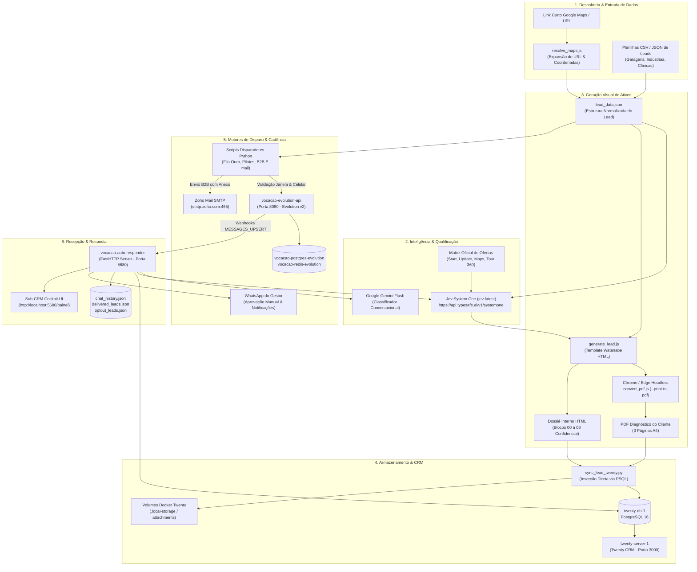

# 02 — Mapa da Arquitetura: Ecossistema de Prospecção Vocação 2027

## 1. Visão Arquitetural

A arquitetura da Máquina de Prospecção da Vocação é distribuída e híbrida, combinando containers Docker (CRM, WhatsApp Engine, n8n, SEO), scripts em Node.js (geração de layout e conversão de PDFs), utilitários em Python (disparadores, integração com CRM, auto-responder e rotinas de IA) e bancos relacionais em PostgreSQL com cache em Redis.

### Diagrama Mermaid da Arquitetura

---

## 2. Inventário Detalhado dos Módulos

### Módulo A: Descoberta e Entrada de Leads
- **Objetivo:** Capturar coordenadas, nomes oficiais e metadados de estabelecimentos a partir de buscas no Google Maps ou listas locais.
- **Localização:**
  - `C:\Users\edubo\.gemini\config\plugins\vocacao\skills\vocacao-prospeccao\scripts\resolve_maps.js`
  - Arquivos CSV em `1 Leads\` (`Planilha_Prospeccao_Garagens_Seminovos_Sorocaba.csv`, `Planilha_Prospeccao_Industrias_Sorocaba.csv`, `Planilha_Prospeccao_Marcenaria_Alto_Ticket_Sorocaba.csv`).
- **Tecnologia:** Node.js (HTTP redirects), CSV nativo.
- **Entradas:** URLs encurtadas (`maps.app.goo.gl`) ou listas de prospecção.
- **Saídas:** Nome da empresa, URL canônica do Google Maps, coordenadas geográficas, bairro e telefone.
- **Estado Atual:** Funcional para resolução de links individuais; geração em lote baseada em CSVs históricos.

---

### Módulo B & C: Scraping, Coleta e Enriquecimento
- **Objetivo:** Analisar status de presença digital (site ativo, site legado, linktree, sem site, ausência de fotos 360 no Google Street View).
- **Localização:**
  - `operacoes\auto_responder_docker\data\build_real_leads.py`
  - `operacoes\enriquecer_leads_twenty.py`
  - `operacoes\sincronizar_leads_crm_completos.py`
- **Tecnologia:** Python, requisições HTTP, regex.
- **Dependências:** Acesso ao banco de dados Twenty CRM e APIs locais.
- **Estado Atual:** Operacional em scripts pontuais; não há um crawler contínuo em segundo plano.

---

### Módulo D & E: Filtragem e Classificação Comercial (IA)
- **Objetivo:** Avaliar matematicamente a maturidade digital do lead, definir a oferta com maior probabilidade de conversão e atribuir um score de urgência.
- **Localização:**
  - `operacoes\auto_responder_docker\jev_engine.py` (Script integrado ao Auto-Responder)
  - `C:\Users\edubo\.gemini\config\plugins\vocacao\skills\vocacao-prospeccao\scripts\jev_classifier.py` (Versão standalone)
- **Tecnologia:** API TypeSafe System One (`jev-latest`), Python `urllib`.
- **Entradas:** Nome do lead, descrição do negócio, presença atual.
- **Saídas:**
  - `oferta_principal` (escolha entre `vocacao_start_850`, `vocacao_update_980`, `combo_maps_tour360_950`, `vocacao_maps_450`).
  - `perfil_maturidade` (`sem_presenca`, `site_legado`, `espaco_ambiente`, `regularizacao_maps`).
  - `perda_conversao_local` (probabilidade de 0.0 a 1.0).
  - `urgencia_score` (0 a 2).
- **Estado Atual:** 🟢 Operacional via requisição REST para `https://api.typesafe.ai/v1/systemone`.

---

### Módulo F: Geração de Abordagens e Ativos de Prospecção
- **Objetivo:** Produzir o kit completo de vendas da Vocação: Relatório do Cliente (PDF A4 diagramado) e Dossiê Interno (HTML Watanabe).
- **Localização:**
  - `C:\Users\edubo\.gemini\config\plugins\vocacao\skills\vocacao-prospeccao\scripts\generate_lead.js`
  - `C:\Users\edubo\.gemini\config\plugins\vocacao\skills\vocacao-prospeccao\scripts\convert_pdf.js`
- **Tecnologia:** Node.js, Google Chrome Headless (`--headless=new`, `--print-to-pdf`).
- **Entradas:** Arquivo JSON padronizado com informações do lead.
- **Saídas:**
  - `Analise-Presenca-Digital-[Nome-do-Lead].pdf` (3 páginas, mínimo 50 KB).
  - `prospeccao-[slug]-interno.html` (dossiê com análise SWOT, objeções e tabela técnica).
- **Estado Atual:** 🟢 Totalmente operacional e com alta qualidade visual.

---

### Módulo G & H: Cadência e Aprovação Humana
- **Objetivo:** Controlar intervalos de envio, aplicar regras anti-bloqueio da Meta, congelar disparos fora das janelas comerciais e solicitar aprovação humana do gestor.
- **Localização:**
  - `operacoes\CONFIG_MOTOR_DISPARO_VOCACOES_START.py`
  - `operacoes\auto_responder_docker\main.py` (linhas 1079-1165 e 1423-1558)
- **Tecnologia:** Python, chamadas WhatsApp para o número administrativo (`ADMIN_WHATSAPP = 5515981512083`).
- **Checkpoints:**
  1. Notificação do lead identificado.
  2. Apresentação de opções de mensagem A/B no Sub-CRM ou WhatsApp.
  3. Bloqueio automático de resposta de bots ou novos decisores.
- **Estado Atual:** 🟡 Conceito sólido, mas violado por scripts de fila que rodaram com timers acelerados sem acionar a trava.

---

### Módulo I: Envio por WhatsApp (Evolution API)
- **Objetivo:** Conectar a linha WhatsApp comercial e despachar mensagens de texto e PDFs em base64.
- **Localização:**
  - Container Docker: `vocacao-evolution-api` (Porta 8080)
  - Stack Docker Compose: `D:\Funnel vendas objeção\local_stack\docker-compose.yml`
- **Tecnologia:** Evolution API v2 (Node.js/Baileys), PostgreSQL 15 (`vocacao-postgres-evolution`), Redis (`vocacao-redis-evolution`).
- **Estado Atual:** 🟢 Container em execução e saudável.

---

### Módulo J: Envio de E-mail B2B
- **Objetivo:** Abordagem consultiva por correio eletrônico corporativo para empresas locais.
- **Localização:**
  - `operacoes\enviar_email_zoho.py`
  - `operacoes\disparador_email_b2b.py`
- **Tecnologia:** Python `smtplib`, Zoho Mail SSL na porta 465 (`contato@vocacao.digital`).
- **Estado Atual:** 🟢 Mecanismo de envio SMTP funcional, com problemas de entregabilidade decorrentes de endereços inexistentes em bases frias.

---

### Módulo K & L: Acompanhamento de Respostas & Armazenamento de Histórico
- **Objetivo:** Ouvir webhooks da Evolution API, registrar mensagens trocadas, classificar sentimentos, detectar opt-outs LGPD e armazenar notas no CRM.
- **Localização:**
  - `operacoes\auto_responder.py` (Script Windows)
  - `operacoes\auto_responder_docker\main.py` (Serviço Dockerizado)
  - Arquivos de estado em `operacoes\auto_responder_docker\data\` (`chat_history.json`, `delivered_leads.json`, `optout_leads.json`).
- **Tecnologia:** Python `http.server`, PostgreSQL (`twenty-db-1`).
- **Estado Atual:** 🔴 O container Docker `vocacao-auto-responder` está parado (Exit Code 127); o script na máquina host não está rodando no momento da inspeção.

---

### Módulo M: Painéis e Dashboards
- **Objetivo:** Apresentar o progresso dos leads, status da fila de disparos e cockpit de controle.
- **Localização:**
  - Sub-CRM Web Server embutido no `auto_responder_docker/main.py` (`/painel` na porta 5680 / 8000).
  - Twenty CRM (`http://localhost:3000`).
  - Arquivos HTML estáticos: `operacoes\build_ultimate_subcrm.py`, `documentacao\Painel-PreSelecao-100Leads-SantaRosalia-Brasilandia.html`.
- **Estado Atual:** 🟡 Twenty CRM 100% ativo; Sub-CRM indisponível porque o container `vocacao-auto-responder` está finalizado.
