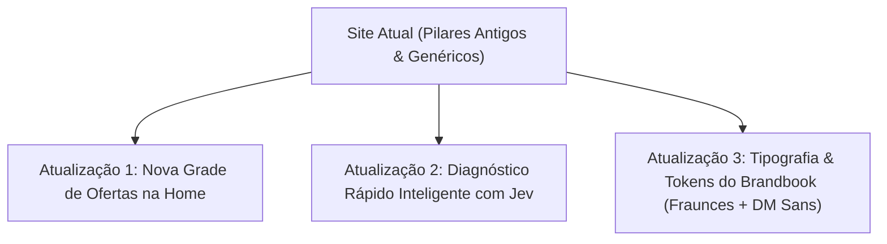

# 🛠️ BRIEFING TÉCNICO & DIRETRIZES DE ATUALIZAÇÃO: VOCACAO.DIGITAL + JEV
> **Destinatário:** Equipe de Desenvolvimento (Dev Vocação)  
> **Objetivo:** Alinhar o site oficial às novas ofertas Grand Slam da Vocação e integrar o Copiloto de Decisão Rápida Jev (TypeSafe System One) no diagnóstico.  
> **Arquivos Afetados no Projeto:** `Site/index.html`, `Site/diagnostico.html`, `Site/lead-machine.js` e `Site/styles-sections.css`.

---

## 📌 1. RESUMO DAS ALTERAÇÕES OBRIGATÓRIAS



---

## 🎯 2. DIRETRIZ 1: NOVA GRADE DE OFERTAS NA HOME (`index.html`)

### Problema Atual:
A seção `#solucao` (Pilares) ainda exibe os 4 pilares conceituais genéricos e não apresenta a nossa esteira comercial real de produtos de caixa.

### Mudança Requerida:
Substituir a grid atual pelos **4 Produtos Oficiais da Vocação**, com preços ancorados, prazos claros e botões diretos de contratação:

1. **Card 01 — Vocação Start (Carro-Chefe / R$ 850,00):**
   * *Headline:* Ativação Digital Local Completa (Entrega em 7 dias úteis).
   * *Entregáveis:* Google Maps Otimizado e Blindado + Vitrine Digital One-Page em subdomínio rápido (`cliente.vocacao.digital`) + Botão direto WhatsApp.
   * *Tag:* Mais Escolhido para Negócios de Bairro.

2. **Card 02 — Vocação Update (R$ 980,00):**
   * *Headline:* Reforma & Aceleração de Site Legado (Entrega em 5 dias úteis).
   * *Entregáveis:* Resgate de conteúdo antigo, carregamento abaixo de 0.5s, 100% mobile-first e fluxo direto de pedido no WhatsApp. Link direto para `/vocacao-update`.

3. **Card 03 — Presença Local no Maps (R$ 450,00):**
   * *Headline:* Reivindicação & Otimização do Perfil no Google (48h a 7 dias).
   * *Entregáveis:* Categorias técnicas certas, blindagem contra perdas, fotos tratadas e link de avaliações 5 estrelas.

4. **Card 04 — Tour Virtual 360° Google Street View (R$ 650 avulso / R$ 950 combo):**
   * *Headline:* Tecnologia Imersiva 5.6K GoPro Max integrada ao Maps e Site.

---

## 🧠 3. DIRETRIZ 2: DIAGNÓSTICO INTELIGENTE COM JEV (`diagnostico.html`)

### Problema Atual:
O `diagnostico.html` hoje possui um formulário longo de 10 passos (`lead-machine.js`) que não dá feedback em tempo real e apenas monta um texto bruto no WhatsApp.

### Solução com Jev (TypeSafe System One):
Transformar o formulário em um **Copiloto de Triagem Instantânea**. O visitante informa:
1. **Nome do Negócio e Bairro/Cidade** (ex: Sorocaba).
2. **Cenário Atual:** ( ) Não tenho site | ( ) Tenho site antigo/lento | ( ) Só uso Instagram/Linktree.
3. **Status do Google Maps:** ( ) Não tenho ficha | ( ) Ficha abandonada com poucas fotos | ( ) Ficha com avaliações mas sem site.

### Lógica Semântica do Jev (`jev-latest`):
O Jev processa as respostas em milissegundos e retorna dados estruturados:
* **`choice` (Recomendação do Pacote Ideal):**
  * `[Vocação Start]` se não tem site e a presença é fraca.
  * `[Vocação Update]` se já possui site antigo ou lento.
  * `[Presença Maps]` se só precisa organizar o endereço e rotas locais.
* **`score` (Grau de Urgência de 0 a 2):**
  * `2` = Crítico (Perdendo clientes diariamente no bairro para concorrentes com presença melhor).
* **`noul` (Probabilidade de Perda de Mercado):**
  * Retorna probabilidade calibrada (ex: `0.87` $\rightarrow$ *"87% de probabilidade de estar perdendo buscas locais no smartphone"*).

### Interface de Entrega para o Usuário (Resultado Imediato):
A tela exibe instantaneamente o **Card de Veredito Técnico**:
* Exibe a barra de urgência com as cores do Brandbook.
* Recomenda o plano certo com botão que abre o WhatsApp já com a mensagem:  
  > *"Olá Edu! O teste do Jev indicou que a [Empresa] tem urgência crítica (nível 2) e o pacote ideal é o Vocação Start. Quero ver os próximos passos."*

---

## 🎨 4. DIRETRIZ 3: DESIGN SYSTEM & BRANDBOOK NO CSS

* **Tipografia:**
  * Títulos de seções e números de destaque: `font-family: 'Fraunces', serif;`
  * Corpo e interface: `font-family: 'DM Sans', sans-serif;`
* **Cores Oficiais (CSS Variables):**
  ```css
  --accent: #0B5E47;          /* Verde Esmeralda Vocação */
  --accent-soft: #E8F4EF;     /* Fundo suave para badges */
  --ink: #121816;             /* Grafite escuro para tipografia */
  --bg: #FAFAF8;              /* Off-white quente editorial */
  --border: #E2E8E5;          /* Borda sutil */
  ```

---

## 📋 5. CHECKLIST DE VALIDAÇÃO PARA O DEV

- [ ] Na Home (`index.html`), substituir os pilares genéricos pelos 4 produtos com os preços oficiais (R$ 450, R$ 650, R$ 850 e R$ 980).
- [ ] Conectar a página `/vocacao-update` com destaque visual na Home.
- [ ] Implementar a chamada ao Jev no intake do diagnóstico (`lead-machine.js`) retornando `choice`, `score` e `noul`.
- [ ] Atualizar o gerador de link do WhatsApp para enviar a recomendação calculada do Jev.
- [ ] Testar em mobile garantindo carregamento abaixo de 1 segundo.
