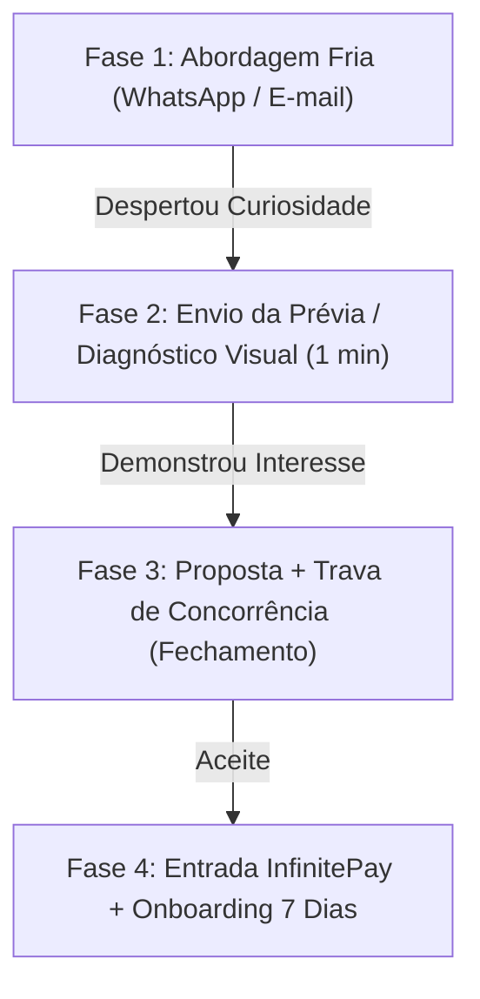

# 🚀 ECOSSISTEMA OPERACIONAL & FUNIL DE VENDAS: VOCAÇÃO START
> **Mês de Execução:** Outubro / 2026  
> **Objetivo de Caixa:** R$ 6.600 a R$ 8.000 (8 a 10 vendas de R$ 850)  
> **Público-Alvo:** Comércios e prestadores de serviços de bairro de Sorocaba (Oficinas mecânicas, buffets, clínicas locais, pet shops, marcenarias).  
> **Canais Oficiais:** WhatsApp (canal primário de resposta rápida) + E-mail Corporativo (canal de formalização e entrega).

---

## 🗺️ 1. O MAPA DO FUNIL EM 4 FASES



---

## 💬 2. SCRIPTS DE WHATSAPP (CANAL PRIMÁRIO)

### Toque 1: Abordagem Fria (Sem Bajulação, Foco em Serviço & LGPD)
> *"Opa [Nome], tudo bem? Edu aqui de Sorocaba.*  
>  
> *Estava pesquisando os serviços de [Segmento] aqui do [Bairro] no Google e encontrei o contato da [Nome da Empresa].*  
>  
> *Vi que vocês têm um trabalho sério na região, mas a apresentação de vocês no Google não reflete isso — faltam fotos atualizadas do trabalho e um botão direto pro WhatsApp.*  
>  
> *Eu montei um resumo rápido mostrando como organizar a presença digital de vocês para quem pesquisar no bairro já abrir conversa direto no seu atendimento.*  
>  
> *Se fizer sentido, te mando aqui pra você dar uma olhada (leva nem 2 minutos). Abraço!*  
>  
> _Contato comercial via dados públicos do Google Maps. Se não desejar receber mensagens, basta responder 'PARAR' que não entraremos mais em contato._"

---

### Toque 2: Envio do Diagnóstico (Quando o Lead Responde "Pode mandar")
> *"Show, [Nome]! Dá uma olhada aqui: [Link do Dossiê/Prévia da Vocação].*  
>  
> *O que nós montamos para a sua empresa:*  
> *1. Sua ficha do Google Maps 100% blindada e organizada com fotos tratadas.*  
> *2. Uma vitrine digital rápida no ar em `[empresa].vocacao.digital` com seus serviços e botão direto pro seu WhatsApp.*  
>  
> *A gente entrega essa estrutura inteira pronta e rodando em 7 dias úteis sem você precisar se preocupar com nada técnico.*  
>  
> *Você consegue dar uma olhada e me falar o que achou?"*

---

### Toque 3: Fechamento com a Trava de Bairro (Negociação)
> *"[Nome], o valor de ativação dessa estrutura completa é de R$ 850 (50% de entrada no Pix e o restante só depois que você conferir tudo no ar, ou no cartão via InfinitePay).*  
>  
> *Um detalhe importante: como trabalhamos com otimização regional, nós só pegamos 1 empresa de [Segmento] aqui no [Bairro] para não gerar concorrência entre clientes no mapa.*  
>  
> *Se você quiser garantir essa vaga para a sua empresa nesta semana, me dá um toque que já emito seu link de entrada e iniciamos hoje mesmo."*

---

## ✉️ 3. TEMPLATES DE E-MAIL (TODAS AS FASES DO FUNIL)

### E-mail 01: Topo de Funil (Primeiro Contato Frio B2B)
* **Assunto:** Presença da [Nome da Empresa] nas buscas do Google no [Bairro]
* **Corpo:**
```text
Olá, [Nome do Responsável], tudo bem?

Meu nome é Edu Bovoline, sou de Sorocaba e atuo com estruturação digital local na Vocação Comunicação & Marketing.

Estava analisando os comércios do segmento de [Segmento] aqui na região do [Bairro] e notei que a [Nome da Empresa] possui um excelente histórico de atendimento, porém a apresentação digital de vocês no Google Maps ainda não reflete a autoridade real do negócio.

Hoje, quem procura pelo seu serviço no smartphone encontra informações desatualizadas e não tem um botão direto para iniciar atendimento no seu WhatsApp.

Montamos uma demonstração prática de como posicionar a sua empresa como referência no bairro com uma estrutura segura e rápida.

Posso te encaminhar essa análise por aqui ou pelo WhatsApp?

Atenciosamente,

Edu Bovoline
Vocação Comunicação & Marketing — Sorocaba/SP
WhatsApp: (15) 98151-2083 | vocacao.digital

---
Aviso LGPD: Este e-mail comercial tem caráter exclusivamente institucional e B2B, com dados coletados da base pública do Google Maps. Caso não deseje receber nossas análises, responda 'DESCADASTRAR' para a remoção imediata dos seus dados.
```

---

### E-mail 02: Meio de Funil (Apresentação da Estrutura Vocação Start)
* **Assunto:** Estrutura digital recomendada para a [Nome da Empresa] (Em anexo)
* **Corpo:**
```text
Olá, [Nome], tudo bem?

Conforme conversamos, segue a análise da presença digital da [Nome da Empresa]:

👉 Acesse a demonstração aqui: [Link do Diagnóstico]

Nosso plano de ativação (Vocação Start) resolve três pontos essenciais:
1. Reestruturação e blindagem da Ficha do Google Maps (fotos tratadas, categorias e canal direto).
2. Vitrine Digital One-Page em subdomínio seguro (cliente.vocacao.digital) com carregamento instantâneo no celular.
3. Botão de conversão direta para o seu WhatsApp e canais oficiais.

Prazo de implementação: 7 dias úteis (chave na mão, sem complexidade técnica para você).

Caso queira entender como subir essa estrutura ainda nesta semana, podemos falar diretamente pelo WhatsApp: (15) 98151-2083.

Abraço,

Edu Bovoline
Vocação Comunicação & Marketing
```

---

### E-mail 03: Fundo de Funil (Formalização da Proposta & Link InfinitePay)
* **Assunto:** Proposta de Ativação Digital: [Nome da Empresa] | Vocação Start
* **Corpo:**
```text
Olá, [Nome], tudo bem?

Para formalizarmos o início da ativação digital da [Nome da Empresa], seguem as condições combinadas:

• Projeto: Sistema Vocação Start (Google Maps Otimizado + Vitrine Digital One-Page)
• Prazo de Entrega: 7 dias úteis a partir do envio das informações básicas
• Investimento: R$ 850,00

Condições de Pagamento:
- Opção 1 (Pix): 50% de entrada (R$ 425,00) na confirmação + 50% após você conferir e validar tudo no ar.
  Chave Pix: [Chave Pix Oficial da Vocação]

- Opção 2 (Cartão de Crédito via InfinitePay):
  Link seguro para parcelamento: [Link da InfinitePay]

Lembramos que mantemos a exclusividade de [Segmento] no [Bairro] reservada para vocês até [Data limite - 48h].

Assim que o comprovante for enviado, nossa equipe inicia a montagem da estrutura imediatamente.

Atenciosamente,

Edu Bovoline
Vocação Comunicação & Marketing
```

---

### E-mail 04: Pós-Venda / Boas-Vindas & Onboarding em 7 Dias
* **Assunto:** Bem-vindo à Vocação! Início da ativação da [Nome da Empresa]
* **Corpo:**
```text
Olá, [Nome], seja muito bem-vindo!

Pagamento confirmado e projeto iniciado. Aqui está o cronograma dos seus próximos 7 dias úteis:

• Dia 1 e 2: Mapeamento técnico e auditoria da Ficha do Google Maps.
• Dia 3 a 5: Construção e diagramação da Vitrine Digital One-Page em cliente.vocacao.digital.
• Dia 6: Integração dos botões de WhatsApp e canais de contato.
• Dia 7: Entrega final para a sua revisão, validação e liberação oficial no Google.

Para começarmos, precisamos apenas de 3 itens rápidos:
1. Suas melhores fotos do espaço e trabalhos (enviar via WhatsApp).
2. Horário de funcionamento e telefones corretos.
3. Concessão de acesso de administrador à sua ficha (enviamos nosso manual de 1 clique).

Qualquer dúvida durante o processo, estamos à disposição direta no WhatsApp (15) 98151-2083.

Vamos em frente!

Edu Bovoline
Equipe Vocação Comunicação & Marketing
```

---

## 📅 4. ROTINA OPERACIONAL DE DISPAROS — OUTUBRO 2026

Para atingir a meta de **R$ 6.600 a R$ 8.000 de caixa líquido**:

| Métrica Semanal | Meta | Observação |
| :--- | :---: | :--- |
| **Disparos Frios (WhatsApp / E-mail)** | 15 por dia (75/semana) | Bairros locais de Sorocaba (sem necessidade de deslocamento). |
| **Diagnósticos Visualizados** | 10 a 15 por semana | Leads que respondem pedindo para ver a prévia. |
| **Fechamentos Semanais** | 2 a 3 vendas | Ticket R$ 850 = **R$ 1.700 a R$ 2.550 / semana**. |
| **Total no Mês (4 semanas)** | 8 a 10 clientes | **R$ 6.800 a R$ 8.500 no caixa**. |

---

## ⚖️ 5. DIRETRIZES DE SEGURANÇA JURÍDICA & LGPD (LEI 13.709/2018)

Para proteger a Vocação e manter 100% de conformidade legal nos contatos frios:

1. **Base Legal (Legítimo Interesse - Art. 7º, IX):** O contato é estritamente institucional e comercial (B2B), direcionado ao telefone e e-mail públicos que a própria empresa disponibilizou no Google Maps e Receita Federal.
2. **Finalidade Legítima:** Oferecer serviço diretamente ligado à atividade econômica da empresa contatada, sem coleta de dados sensíveis ou pessoais de pessoas físicas.
3. **Direito de Opt-Out Imediato:** Toda primeira mensagem (WhatsApp e E-mail) contém a instrução de saída rápida (`PARAR` ou `DESCADASTRAR`).
4. **Política de Descarte (Lista Negra de Bloqueio):** Se o contato responder pedindo para parar, o número/e-mail deve ser marcado imediatamente no Twenty CRM como `DESCADASTRADO / NÃO CONTATAR` e nunca mais receber disparos.

