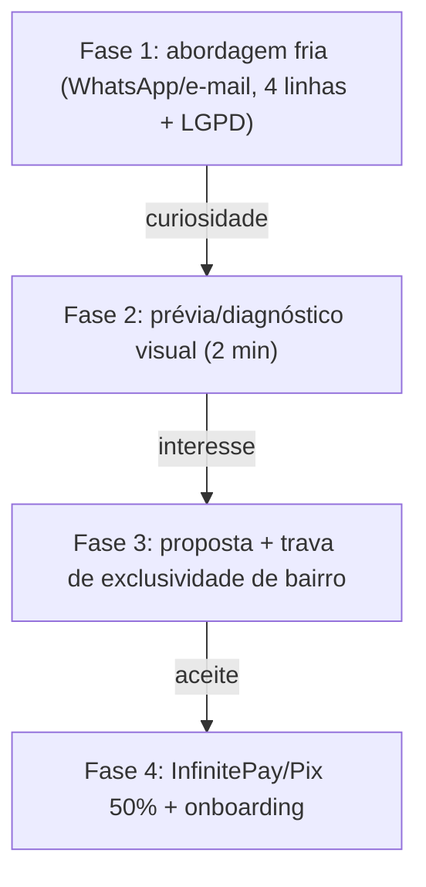

# Matriz Oficial de Ofertas e Qualificação — Vocação 2027

> **Vigência:** outubro/2026 (P5 da auditoria — fonte humana do catálogo)
> **Fonte de verdade do código:** `operacoes/ofertas_catalogo.py`
> **Como validar:** `python operacoes/verificar_catalogo.py`
>
> Este documento e o catálogo em Python precisam dizer a mesma coisa. Se você
> mudar preço, escopo ou prazo, mude **primeiro** no catálogo e rode o
> verificador — ele acusa qualquer divergência entre os dois e os motores do Jev.

---

## 1. Esteira unificada

| Solução | O que inclui (escopo fechado) | O que NÃO inclui | Ticket | Prazo |
| :--- | :--- | :--- | ---: | :--- |
| **Vocação Presença no Maps** | Reivindicação da ficha no nome do dono, dados e categorias corretos, link direto de WhatsApp e fotos tratadas. | Fotos novas presenciais e site. | **R$ 450,00** | 48h a 7 dias |
| **Tour Virtual 360° Avulso (Street View)** | Captura presencial com GoPro Max (5 a 7 pontos), costura técnica e publicação no Google Street View oficial. | Mexer no site ou na ficha do Maps. | **R$ 650,00** | 3 a 5 dias |
| **Vocação Start** *(carro-chefe)* | Google Maps otimizado + Vitrine Digital One-Page em subdomínio seguro (`cliente.vocacao.digital`) com botão direto de WhatsApp. | E-commerce com carrinho, blog e área de membros. | **R$ 850,00** | 7 dias úteis |
| **Combo Maps + Tour 360° GoPro Max** | Otimização completa do Google Maps + Tour Virtual 360° GoPro Max publicado no Google Street View. | Criação de site. | **R$ 950,00** | 7 dias úteis |
| **Vocação Update** | Reforma e modernização de site existente: carregamento abaixo de 0,5s, mobile-first e fluxo direto de pedido para o WhatsApp. | Reescrita do zero ou fotos presenciais. | **R$ 980,00** | 5 dias úteis |

### Upsells opcionais

- **Domínio próprio:** registro no Registro.br (`.com.br`) por **R$ 40,00/ano**, no CPF/CNPJ do cliente.
- **E-mail corporativo:** configuração no Zoho Mail (grátis para 1 usuário ou R$ 9,90/mês até 5 contas).
- **Versão Pro com vídeo de fundo:** adicional de **R$ 1.350,00** (total R$ 2.200,00), para quem já tem vídeo institucional pronto.

---

## 2. Perfis de maturidade (entrada do Jev)

| Perfil | Critério |
| :--- | :--- |
| `sem_presenca` | Invisível ou sem site: apenas redes sociais ou ficha do Google Maps abandonada. |
| `site_legado` | Possui site, mas antigo, lento, não responsivo ou sem botão direto para WhatsApp. |
| `espaco_ambiente` | Espaço físico atraente que se beneficiaria muito de tour 360° no Street View. |
| `regularizacao_maps` | Empresa consolidada no mundo real, mas com ficha do Maps desatualizada ou não reivindicada. |

## 3. Urgência de estruturação

| Nível | Critério |
| :--- | :--- |
| Baixa | Já tem presença razoável e canais de conversão ativos. |
| Média | Presença parcial com falhas óbvias de conversão no mobile. |
| Crítica | Sem vitrine funcional, sem botão de WhatsApp ou ficha do Maps queimando clientes no bairro. |

---

## 4. Funil de abordagem

**Regra de copy (P2):** a primeira mensagem **não afirma** fato não confirmado
sobre o lead (fotos, site, WhatsApp, e-mail). Ela oferece a análise. Nunca usar
"se fizer sentido", "vocês não têm", "faltam fotos", "usam @gmail.com".

---

## 5. Cobrança

- **Pix 50/50:** 50% na entrada (R$ 425,00 no Vocação Start) e 50% após validação no ar dentro do prazo.
- **Cartão:** link parcelado via InfinitePay no fechamento.
- **Garantia:** o cliente valida o sistema funcionando antes de liquidar o saldo.

---

## 6. Trava de exclusividade de bairro

> "Como a gente trabalha com otimização regional no mapa, só atendemos 1 empresa
> do seu segmento no seu bairro para não gerar concorrência entre clientes. Por
> isso queria ver se você quer avançar agora para congelarmos a sua vaga."

---

## 7. Dados e estatísticas (somente fontes reais)

A Vocação não usa métrica inventada. Toda afirmação de autoridade em relatório
ou proposta cita pesquisa pública:

- **2x** mais interesse/reserva em fichas com fotos e tour virtual — *Google / Ipsos MediaCT*.
- **67%** dos consumidores querem tours virtuais na ficha antes de visitar — *Google Street View Consumer Research*.
- **130%** mais propensão a agendar na faixa 18–34 anos — *Ipsos MediaCT para Google*.
- **87%** pesquisam a empresa no Google antes de contratar — *BrightLocal Local Consumer Review Survey*.
- **76%** dos que fazem busca local no celular visitam o negócio em até 24h — *Google Consumer Insights*.
